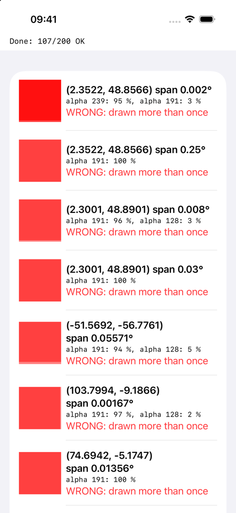
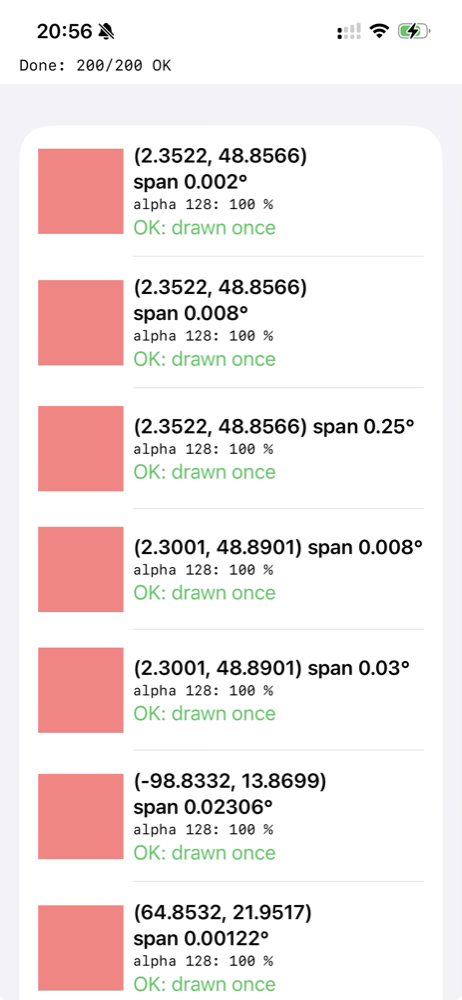

# MLNMapSnapshotter draws a translucent fill more than once (iOS Simulator)

A minimal reproduction for MapLibre Native iOS: a snapshot of a style holding one GeoJSON polygon,
larger than the view, filled with `rgba(255,0,0,0.5)`. Every pixel should have alpha 128. Depending on
the zoom and position, the whole image (or tile-aligned regions of it) comes out at alpha 191 or 239,
as if the fill were drawn two or three times.

Only the iOS Simulator is affected: a physical iPhone renders every case correctly.

| iOS 26.5 simulator: 107/200 correct | iPhone 16e, iOS 26.6.2: 200/200 correct |
|---|---|
|  |  |

The red squares should all look like the pale ones: on the simulator, the darker ones are the fill
drawn two or three times.

## Run

```sh
xcodebuild test -scheme SnapshotAlphaRepro-Package -destination 'platform=iOS Simulator,name=iPhone 17'
```

Or open `Package.swift` in Xcode and run the tests (⌘U). No network access or token needed.

`ReproApp/` is the same check as an app (Xcode project generated by XcodeGen from `project.yml`),
for a physical device: it renders the five cases above and 195 more (deterministic centers around
the world, spans from 0.001° to 2°), and lists each with its image, its alpha values and OK / WRONG.

## Result (MapLibre iOS 7.0.0 and 6.31.0, iOS 26.5 and iOS 27 simulators, Xcode 27.2)

```
center (2.3522, 48.8566) span 0.002° -> alpha 239: 95 %, alpha 191: 3 %
center (2.3522, 48.8566) span 0.008° -> alpha 128: 100 %
center (2.3522, 48.8566) span 0.25°  -> alpha 191: 100 %
center (2.3001, 48.8901) span 0.008° -> alpha 191: 96 %, alpha 128: 3 %
center (2.3001, 48.8901) span 0.03°  -> alpha 191: 100 %
```

Expected: alpha 128 everywhere (one layer of 50 %).

## What we observed

- Deterministic: the same bounds give the same result on every run.
- Not timing or loading: the style has no remote source.
- An opaque `background` layer under the fill does not help: the red accumulates over it, so the fill
  is drawn several times within one frame.
- The same with `fill-opacity: 0.5` and an opaque color, and with `fill-antialias: false`.
- The GeoJSON source's `maxzoom` changes it: with `maxzoom: 12`, the two small spans above are correct.
- The same style and bounds through MapLibre Android 13.6.1's snapshotter give alpha 128 everywhere.
- ReproApp's 200 cases: 107 correct and 93 wrong on the iOS 26.5 simulator, the same cases on every
  run; 200 correct on a physical iPhone 16e (iOS 26.6.2), over several runs.

---

The investigation, this repository and its README were produced with an AI coding assistant (Claude Code),
checked and run by a human on the simulator and the device.
